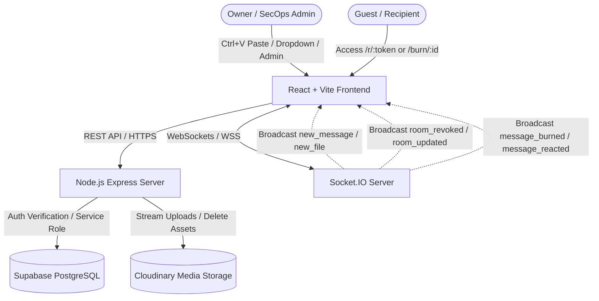
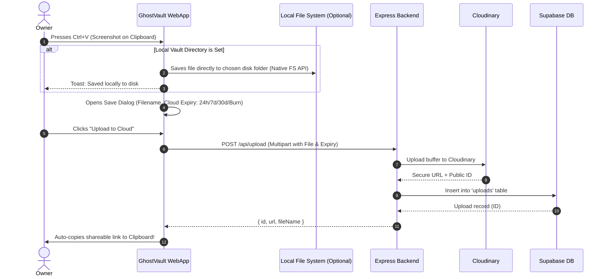
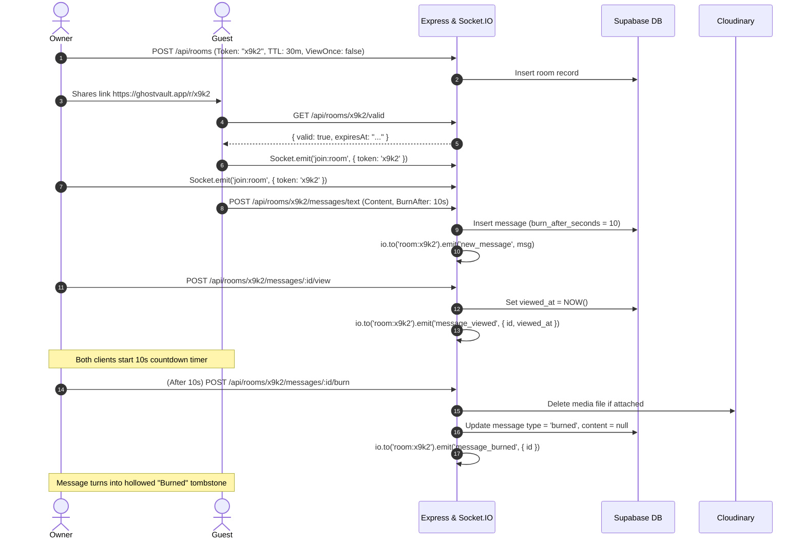

# 👻 GhostVault (SecOps Console) — Complete AI Project Prompt & Architectural Blueprint

> **How to use this file:**  
> Copy and paste this entire document (or specific sections) into any AI model (e.g., Claude 3.5 Sonnet, GPT-4o, Gemini 1.5 Pro, DeepSeek V3) to give it full context of the GhostVault project. The prompt includes the high-level vision, complete tech stack, system architecture, database schema, API & socket specifications, UI/UX screen breakdown, and targeted meta-prompts for future enhancements.

---

## 📋 Table of Contents
1. [AI System Role & Meta-Prompt Header](#-1-ai-system-role--meta-prompt-header)
2. [Project Identity & Core Vision](#-2-project-identity--core-vision)
3. [Technology Stack & Dependency Breakdown](#-3-technology-stack--dependency-breakdown)
4. [Monorepo Architecture & Directory Map](#-4-monorepo-architecture--directory-map)
5. [System Architecture & Data Flows](#-5-system-architecture--data-flows)
6. [Database Schema & Data Model](#-6-database-schema--data-model)
7. [REST API & Socket.IO Event Reference](#-7-rest-api--socketio-event-reference)
8. [Comprehensive Feature Catalog & Logic](#-8-comprehensive-feature-catalog--logic)
9. [UI/UX Wireframes, Component Hierarchy & Navigation](#-9-uiux-wireframes-component-hierarchy--navigation)
10. [Design System, Theme Tokens & Styling](#-10-design-system-theme-tokens--styling)
11. [Ready-to-Use AI Prompts for Enhancements](#-11-ready-to-use-ai-prompts-for-enhancements)

---

## 🤖 1. AI System Role & Meta-Prompt Header

*Copy the block below to instruct another AI to act as the Principal Architect and Developer for GhostVault:*

```markdown
You are an elite Full-Stack Principal Engineer and Senior UI/UX Architect specializing in modern React, Node.js, Real-time WebSockets, Cyberpunk/DevSecOps design aesthetics, and cloud security.

You are pair-programming with the lead developer of "GhostVault" (codenamed snapvault), an ephemeral, secure DevSecOps file-sharing terminal and real-time dead-drop room application.

Your goals:
1. Understand the full architecture, code patterns, state machines, and UX workflows documented below.
2. Adhere strictly to the existing design language: Cyber Midnight dark mode, emerald (#10b981) and cyan (#06b6d4) glowing terminal accents, warm cream light mode, and ultra-snappy micro-interactions.
3. Write clean, production-ready, highly modular code with no placeholders or pseudo-code.
4. Always prioritize security, zero-trace data purging, responsive mobile-first layouts, and seamless real-time synchronization.
```

---

## 🌐 2. Project Identity & Core Vision

- **Project Name:** GhostVault (Console Name: `GhostVault | SecOps Console`, internal repo: `snapvault`)
- **Tagline:** *"Paste. Share. Vanish."*
- **Primary Use Cases:**
  1. **Instant Screenshot Vault:** Press `Ctrl+V` anywhere on the screen to instantly upload a clipboard screenshot to Cloudinary, store its metadata in Supabase, and get a short shareable URL copied straight to your clipboard.
  2. **Native File System Saving:** Direct filesystem writing using the Native File System Access API, saving pasted screenshots straight to a selected directory on the user's hard drive without browser "Save As" prompts.
  3. **Secure Ephemeral Tunnels (Dead-Drops):** Temporary live collaboration channels identified by short 4-character tokens (e.g. `/r/x9k2`) or custom human-readable slugs. Guests and owners can exchange text, files, and voice notes in real-time.
  4. **Burn-After-Reading (`/burn/:id`):** Single-view payload links. The server fetches the file buffer, streams it to the user, and immediately purges both the database record and the Cloudinary cloud asset permanently.
  5. **Ephemeral Self-Destruct Messages:** Snapchat-style countdown timers (5s, 10s, 1m) inside live chat rooms. Once opened by the recipient, the timer starts; when expired, the message is hollowed out into a tombstone ("burned") and purged from cloud storage.
  6. **In-Browser Folder Zipping:** Drag and drop an entire nested folder into the dashboard; client-side JSZip zips it recursively on-the-fly and uploads a single `.zip` asset.
  7. **Emergency Panic Mode:** Press `Esc` twice rapidly to instantly scrub the entire UI off the screen; restore access only by clicking a hidden micro-trigger.

---

## 🛠️ 3. Technology Stack & Dependency Breakdown

### Frontend Layer (`client/`)
- **Core Framework:** React 18.2 (SPA via Vite 4.4)
- **Routing:** React Router v7 (`react-router-dom`)
- **Styling:**
  - Tailwind CSS v3.4 for utility layout grids and flexboxes
  - Custom Vanilla CSS Design System (`client/src/index.css`) with CSS custom properties for dual themes (Dark Cyber Midnight vs Warm Cream Light)
  - Custom glassmorphism, glowing borders, CRT scanline grids, and terminal animations
- **Animation & Transitions:** Framer Motion (`framer-motion` v12) for smooth modals, swipe-to-reply spring physics, toast slide-ins, and tab switching
- **Icons:** Lucide React (`lucide-react`)
- **Real-Time Client:** Socket.IO Client (`socket.io-client` v4.8)
- **Auth & Database SDK:** Supabase Client (`@supabase/supabase-js` v2.105)
- **HTTP Client:** Axios (`axios` v1.15)
- **Local File & Zip Utilities:**
  - `jszip` (v3.10) for in-browser client-side recursive folder zipping
  - `idb-keyval` (v6.2) for IndexedDB storage of Native File System directory handles
- **Code Syntax Highlighting:** `react-syntax-highlighter` (Prism engine with `atomDark` theme) for Markdown code fence rendering
- **Notifications:** `react-hot-toast`
- **QR Codes:** `qrcode.react` (SVG mode)
- **Drag & Drop:** `react-dropzone`
- **PWA Support:** Custom Service Worker (`sw.js`), Web App Manifest (`manifest.json`), mobile viewport `100dvh`, and Web Share Target API (`/share-target`).

### Backend Layer (`server/`)
- **Runtime & Framework:** Node.js with Express.js (`express` v4.18)
- **Real-Time Engine:** Socket.IO (`socket.io` v4.7) with room-based pub/sub channels
- **Security & Headers:** Helmet (`helmet` v8.1), CORS (`cors` v2.8)
- **Storage & File Pipeline:**
  - Multer (`multer`) with `multer-storage-cloudinary`
  - Cloudinary Node SDK (`cloudinary` v1.41)
  - Auto-deletion routines for images, PDFs, videos, and raw documents
- **Database Client:** Supabase JS (`@supabase/supabase-js` v2.39) using `SUPABASE_SERVICE_ROLE_KEY` to securely bypass RLS on verified server operations
- **Token Generation:** Custom Nanoid-based token generator (`nanoid` v3.3) for 4-character alphanumeric room codes

### Cloud Infrastructure & Third Parties
- **Database:** Supabase (Managed PostgreSQL with Row Level Security and Realtime)
- **Media CDN:** Cloudinary (Dynamic transformations: PDF page 1 thumbnails, video poster frames, audio encoding)
- **Hosting / Deployments:**
  - Frontend: Vercel (Automatic GitHub CI/CD on `main`)
  - Backend: Render Web Service (Automatic GitHub CI/CD on `main`)
- **Cold-Start Resilience:** Integrated `useServerHealth` hook and `<ServerWakeUp />` overlay to gracefully handle Render free-tier spin-up latency (approx. 50s).

---

## 📁 4. Monorepo Architecture & Directory Map

```text
ghost-vault/
├── package.json               # Root monorepo scripts (dev, dev:server, dev:client, install:all)
├── supabase-schema.sql        # Canonical PostgreSQL schema for Supabase
├── DEPLOYMENT.md              # Production deployment playbook (Vercel + Render)
├── README.md                  # Public documentation & feature showcase
│
├── client/                    # Vite + React Frontend
│   ├── public/
│   │   ├── manifest.json      # PWA Progressive Web App configuration
│   │   ├── sw.js              # Service Worker for offline cache & PWA install
│   │   └── robots.txt         # SEO configuration
│   ├── src/
│   │   ├── components/
│   │   │   ├── ChatWindow.jsx         # Full-featured WhatsApp/Telegram style SecOps chat
│   │   │   ├── ChatWindow.css         # Chat layout, bubble gradients, pin bar, audio player
│   │   │   ├── FullScreenImageViewer.jsx # Pan, zoom, rotate, inspect image viewer
│   │   │   ├── FullScreenImageViewer.css
│   │   │   ├── GhostLogo.jsx          # Vector floating ghost brand icon
│   │   │   ├── InstallPrompt.jsx      # PWA install banner for iOS/Android
│   │   │   ├── ServerWakeUp.jsx       # Cold-start spin-up status modal
│   │   │   ├── ShortcutsModal.jsx     # Keyboard shortcut cheatsheet overlay ('?' key)
│   │   │   ├── Sidebar.jsx            # Desktop & Mobile navigation rail
│   │   │   └── Sidebar.css
│   │   ├── contexts/
│   │   │   ├── AuthContext.jsx        # Supabase auth state, login/logout methods
│   │   │   ├── SocketContext.jsx      # Global Socket.io connection & room join helpers
│   │   │   └── ThemeContext.jsx       # Dark ('dark') vs Light ('light') toggle & storage
│   │   ├── hooks/
│   │   │   ├── useServerHealth.js     # Health check poller for backend wake-up
│   │   │   └── useTheme.js            # Theme hook consumer
│   │   ├── lib/
│   │   │   ├── api.js                 # Axios instance with auth interceptor
│   │   │   └── supabase.js            # Frontend Supabase client initialization
│   │   ├── utils/
│   │   │   ├── clipboard.js           # Robust copy-to-clipboard helper
│   │   │   ├── formatBytes.js         # File size humanizer (KB, MB, GB)
│   │   │   └── fsAccess.js            # Native File System Access API wrapper
│   │   ├── pages/
│   │   │   ├── LandingPage.jsx        # Public home, typewriter hero, live IP badge
│   │   │   ├── LoginPage.jsx          # Cyberpunk terminal login card
│   │   │   ├── AuthCallback.jsx       # Supabase OAuth/magic link callback handler
│   │   │   ├── DashboardPage.tsx      # Master SecOps Command Center (Tabs, Tunnels, Uploads)
│   │   │   ├── GuestRoomPage.jsx      # Public interface for ephemeral guest tunnels (/r/:token)
│   │   │   ├── GuestRoomPage.css
│   │   │   ├── BurnViewPage.jsx       # Single-view self-destructing secret page (/burn/:id)
│   │   │   ├── AssetViewPage.jsx      # Public code/text syntax-highlighted viewer (/v/:id)
│   │   │   ├── ShareTargetPage.jsx    # PWA native mobile share target handler
│   │   │   └── NotFoundPage.jsx       # Custom 404 / Expired tunnel screen
│   │   ├── App.jsx                    # Route definitions, PanicMode, OfflineOverlay
│   │   ├── index.css                  # Master design system & CSS variables
│   │   └── main.jsx                   # React root entry point
│   ├── tailwind.config.js             # Tailwind configuration mapped to custom CSS tokens
│   └── vite.config.js
│
└── server/                    # Express + Socket.IO Backend
    └── src/
        ├── index.js           # Server bootstrap, CORS, Socket.IO attachment, routes mount
        ├── lib/
        │   ├── cloudinary.js  # Cloudinary config, multer engines, delete helper
        │   ├── supabase.js    # Service-role Supabase client
        │   └── token.js       # 4-character alphanumeric random token generator
        ├── middleware/
        │   └── requireOwner.js# Supabase JWT validator & owner email check
        └── routes/
            ├── rooms.js        # Room CRUD, pause/resume, TTL extension, permanent purge
            ├── messages.js     # Chat messages, file upload, reactions, pins, burn countdown
            ├── upload.js       # Unified upload endpoint (owner direct vs guest room)
            ├── uploads.js      # Owner vault assets listing, pagination, deletion
            ├── burn.js         # Burn-after-reading single fetch & purge controller
            └── bugs.js         # Bug reporting endpoint (Supabase + local JSON fallback)
```

---

## 🏗️ 5. System Architecture & Data Flows

### High-Level Architecture Diagram


### Key Workflow 1: The Instant Clipboard & File System Access Flow


### Key Workflow 2: Secure Tunnel & Ephemeral Messaging Flow


### Key Workflow 3: Burn-After-Reading (`/burn/:id`)
1. Owner uploads an ultra-sensitive credential or image marked as `burn`.
2. Backend assigns `expires_at = '1970-01-01T00:00:01Z'`.
3. Recipient visits `/burn/:id` and clicks **"Reveal Secret Payload"**.
4. Frontend requests `GET /api/burn/:id`.
5. Backend verifies the record exists, downloads the file buffer from Cloudinary via Axios, immediately deletes the database row from Supabase, triggers asynchronous deletion of the Cloudinary asset, and streams the buffer with correct `Content-Type` headers directly to the recipient's browser.
6. Any subsequent refresh returns `404: This message has already self-destructed`.

---

## 🗄️ 6. Database Schema & Data Model

Run directly in the Supabase PostgreSQL Query Editor:

```sql
-- ── 1. Rooms (Ephemeral Tunnels) ──────────────────────────────────────────────
CREATE TABLE IF NOT EXISTS rooms (
  id                       UUID PRIMARY KEY DEFAULT gen_random_uuid(),
  token                    TEXT UNIQUE NOT NULL,        -- e.g. "x9k2" or custom slug
  created_at               TIMESTAMPTZ DEFAULT NOW(),
  expires_at               TIMESTAMPTZ,                 -- nullable = infinite session
  view_once                BOOLEAN DEFAULT FALSE,       -- auto-revoke after first file upload
  note                     TEXT,                        -- optional purpose label
  is_active                BOOLEAN DEFAULT TRUE,
  is_paused                BOOLEAN DEFAULT FALSE,       -- true if owner frozen access
  paused_remaining_seconds INTEGER                      -- captures exact seconds left when paused
);
CREATE INDEX IF NOT EXISTS rooms_token_idx ON rooms(token);
ALTER TABLE rooms ENABLE ROW LEVEL SECURITY;

-- ── 2. Uploads (Vault Screenshots & Guest Uploads) ────────────────────────────
CREATE TABLE IF NOT EXISTS uploads (
  id                    UUID PRIMARY KEY DEFAULT gen_random_uuid(),
  owner_id              UUID,                           -- NULL if uploaded by guest
  room_id               UUID REFERENCES rooms(id) ON DELETE SET NULL,
  file_name             TEXT NOT NULL,
  cloudinary_url        TEXT NOT NULL,
  cloudinary_public_id  TEXT,
  file_type             TEXT,                           -- e.g. "image/png", "application/pdf"
  created_at            TIMESTAMPTZ DEFAULT NOW(),
  expires_at            TIMESTAMPTZ                     -- optional auto-delete date
);
CREATE INDEX IF NOT EXISTS uploads_owner_idx ON uploads(owner_id, created_at DESC);
CREATE INDEX IF NOT EXISTS uploads_room_idx  ON uploads(room_id, created_at ASC);
ALTER TABLE uploads ENABLE ROW LEVEL SECURITY;

CREATE POLICY "Owner reads own uploads" ON uploads
  FOR SELECT USING (auth.uid() = owner_id);

-- ── 3. Messages (Encrypted Room Chat & Payload Exchanges) ──────────────────────
CREATE TABLE IF NOT EXISTS messages (
  id                 UUID PRIMARY KEY DEFAULT gen_random_uuid(),
  room_id            UUID NOT NULL REFERENCES rooms(id) ON DELETE CASCADE,
  sender             TEXT NOT NULL,                     -- 'owner' | 'guest'
  type               TEXT NOT NULL,                     -- 'text' | 'image' | 'file' | 'burned'
  content            TEXT,                              -- markdown/code text content
  file_url           TEXT,                              -- Cloudinary media CDN URL
  file_name          TEXT,
  file_size          BIGINT,
  burn_after_seconds INTEGER,                           -- ephemeral timer in seconds (5, 10, 60)
  viewed_at          TIMESTAMPTZ,                       -- timestamp when countdown started
  reply_to_id        UUID REFERENCES messages(id) ON DELETE SET NULL, -- quoted message ID
  reactions          JSONB DEFAULT '{}'::jsonb,         -- { "👍": ["owner", "guest_ip"], "🔥": [...] }
  is_pinned          BOOLEAN DEFAULT FALSE,             -- sticky message flag
  created_at         TIMESTAMPTZ DEFAULT NOW()
);
CREATE INDEX IF NOT EXISTS messages_room_idx ON messages(room_id, created_at ASC);
ALTER TABLE messages ENABLE ROW LEVEL SECURITY;

-- ── 4. Bug Reports ─────────────────────────────────────────────────────────────
CREATE TABLE IF NOT EXISTS bug_reports (
  id          UUID PRIMARY KEY DEFAULT gen_random_uuid(),
  description TEXT NOT NULL,
  email       TEXT,                                     -- optional contact email
  page        TEXT,                                     -- context e.g. "guest-room/x9k2"
  role        TEXT DEFAULT 'guest',                     -- 'guest' | 'owner'
  user_agent  TEXT,
  created_at  TIMESTAMPTZ DEFAULT NOW()
);
CREATE INDEX IF NOT EXISTS bug_reports_created_idx ON bug_reports(created_at DESC);
ALTER TABLE bug_reports ENABLE ROW LEVEL SECURITY;
```

---

## 📡 7. REST API & Socket.IO Event Reference

### REST Endpoints

| Method | Endpoint | Auth | Description |
| :--- | :--- | :--- | :--- |
| `POST` | `/api/upload` | Optional (JWT / `x-room-token`) | Unified upload for screenshots and room payloads |
| `GET` | `/api/uploads` | Owner JWT | Paginated list of owner vault files (`?page=1&limit=20`) |
| `DELETE` | `/api/uploads/:id` | Owner JWT | Deletes asset from Supabase and Cloudinary |
| `GET` | `/api/uploads/:id/public` | Public | Retrieves public metadata for an asset viewer |
| `GET` | `/api/rooms` | Owner JWT | Lists all active and historical rooms with upload tallies |
| `POST` | `/api/rooms` | Owner JWT | Creates room (`{ expiresInMinutes, viewOnce, note, customToken }`) |
| `GET` | `/api/rooms/:token/valid` | Public | Validates room status (checks `is_active`, expiration, pause state) |
| `PATCH` | `/api/rooms/:token` | Owner JWT | Edits room: extends TTL (`addMinutes`), pauses/resumes, updates note |
| `DELETE` | `/api/rooms/:token` | Owner JWT | Revokes room (marks `is_active = false`, notifies guests) |
| `DELETE` | `/api/rooms/:token/permanent` | Owner JWT | Hard delete: wipes room, Cloudinary files, and all messages |
| `GET` | `/api/rooms/:token/messages` | Token / Owner | Fetches full chat history for a room |
| `POST` | `/api/rooms/:token/messages/text` | Token / Owner | Sends text/code message (supports reply and burn timer) |
| `POST` | `/api/rooms/:token/messages/file` | Token / Owner | Uploads file/voice note payload to room |
| `POST` | `/api/rooms/:token/messages/:id/view` | Token / Owner | Triggers the self-destruct timer countdown |
| `POST` | `/api/rooms/:token/messages/:id/burn` | Token / Owner | Purges expired payload and marks as burned |
| `POST` | `/api/rooms/:token/messages/:id/react` | Token / Owner | Toggles emoji reaction (admin has force-remove superpower) |
| `POST` | `/api/rooms/:token/messages/:id/pin` | Token / Owner | Toggles pinned status of a message |
| `DELETE` | `/api/rooms/:token/messages/:id` | Owner JWT | Deletes an individual message from room |
| `GET` | `/api/burn/:id` | Public | One-time secret download & purge |
| `POST` | `/api/bugs` | Public | Submits bug report with user agent and role |
| `GET` | `/api/bugs` | Owner JWT | Fetches all submitted bug reports |

### Socket.IO Real-Time Channels & Events

```text
Namespaces / Rooms:
  room:<token>     --> Joined by guests and owner monitoring a specific tunnel
  owner:<userId>   --> Personal notification channel for the vault owner
```

| Event Name | Direction | Payload | Description |
| :--- | :--- | :--- | :--- |
| `join:room` | Client ➔ Server | `{ token }` | Joins the socket room for real-time sync |
| `join:owner` | Client ➔ Server | `{ userId }` | Registers owner's persistent channel |
| `new_message` | Server ➔ Room | Message Object | Broadcasts incoming chat message / payload |
| `new_file` | Server ➔ Room | Upload Object | Notifies clients of new dropped file |
| `message_viewed`| Server ➔ Room | `{ id, viewed_at }` | Initiates synchronized burn countdowns |
| `message_burned`| Server ➔ Room | `{ id }` | Replaces message bubble with burned state |
| `message_reacted`| Server ➔ Room| `{ messageId, reactions }` | Real-time emoji reaction counter update |
| `message_pinned`| Server ➔ Room | `{ messageId, is_pinned }` | Updates pinned banner in chat header |
| `message_deleted`| Server ➔ Room| `{ id }` | Removes deleted message from thread |
| `room_revoked` | Server ➔ Room | `{ token }` | Kicks guests to 404 / expired screen |
| `room_updated` | Server ➔ Room | `{ token, expiresAt, isPaused, note }` | Live updates timer & pause freeze |

---

## ⚡ 8. Comprehensive Feature Catalog & Logic

### 1. True Pause & Resume (Tunnel Freezing)
- **Problem:** If an owner temporarily leaves their desk, an active guest tunnel could leak data or expire while unattended.
- **Implementation:**
  - Owner clicks **Pause** in the tunnel row or chat kebab menu.
  - Server calculates `paused_remaining_seconds = expires_at - NOW()` and sets `expires_at = NULL, is_paused = true`.
  - Connected guests are immediately kicked or blocked with a "Room Paused by Admin" screen.
  - When resumed, server sets `expires_at = NOW() + paused_remaining_seconds * 1000, is_paused = false`.
  - The countdown timer literally freezes in place without losing time!

### 2. Snapchat-Style Self-Destructing Messages
- User selects a burn duration from the chat timer dropdown: `5s`, `10s`, or `1m`.
- The payload sends with `burn_after_seconds = 10`.
- Initially, the message bubble shows a blurred preview with an eye icon.
- When the recipient clicks or views the message, a `/view` POST is fired.
- Both sender and receiver render a live pulsing countdown clock.
- Once 0 is reached, the client triggers `/burn`. The Cloudinary asset is removed, text is nulled, and the database status updates to `burned`.
- The UI replaces the bubble with a hollowed-out ghost tombstone: `[Payload Self-Destructed]`.

### 3. Telegram-Style Voice Notes
- Microphone button in `<ChatWindow />`.
- Uses standard browser `navigator.mediaDevices.getUserMedia({ audio: true })` and `MediaRecorder`.
- Visual waveform animation during active recording with timer (`0:04`, `0:05`...).
- Transcribes the audio directly into an `.mp3` / `.webm` blob and submits it via multipart `/messages/file`.
- Custom in-bubble audio player with play/pause, scrub bar, and duration timestamps.

### 4. Swipe-to-Reply & Pinned Messages
- **Swipe-to-Reply:** Users can swipe any message bubble to the right (powered by Framer Motion drag gestures on touch devices). Releasing triggers quoted reply mode, docking the target message above the text input bar.
- **Pinned Banner:** Any message can be pinned. Pinned messages appear in a persistent sticky banner at the top of the chat window with quick jump-to-message anchor functionality.

### 5. Double-Esc Panic Mode
- Global event listener in `App.jsx` tracks `keydown` intervals for the `Escape` key.
- If pressed twice within 500ms, the class `.panic-mode` is added to `document.body`.
- All dashboard content, chats, and sensitive documents instantly vanish to a blank dark screen.
- A tiny 2px stealth dot (`.panic-dot`) in the bottom-right corner restores the dashboard when clicked.

---

## 🖥️ 9. UI/UX Wireframes, Component Hierarchy & Navigation

### Application Route Map

```text
/ (LandingPage)
  ├── Desktop Top Navbar (Brand Logo, SecOps Badge, Theme Toggle, GitHub Link, Login/Console CTA)
  ├── Hero Section (Typewriter "Paste. Share. Vanish.", Client IP badge, CTA Button)
  ├── Interactive Demo Preview Terminal
  ├── Key Features Grid (6 Cyberpunk Cards)
  └── Footer (Security Disclaimers & Copyright)

/login (LoginPage)
  ├── Back to Home ("Abort_Login")
  ├── Cyberpunk Grid Background with scanlines
  ├── Terminal Login Card
  │   ├── Header ("Authenticate Session", Lock Icon)
  │   ├── Email & Password Inputs (with password visibility toggle)
  │   └── "Initialize Connection" Action Button
  └── IP Geolocation Badge ("AUTHORIZED ACCESS ONLY")

/dash (DashboardPage — Owner Protected Route)
  ├── Top Bar (UTC Live Clock, Node Status Indicator, Mobile Drawer Toggle)
  ├── Left Sidebar Navigation Rail (Desktop) / Bottom Sheet (Mobile):
  │   ├── Brand Header & Logo
  │   ├── Nav Button: [Activity] Dashboard
  │   ├── Nav Button: [FolderLock] Asset Store
  │   ├── Nav Button: [MessageSquare] Secure Tunnels (Badge for active tunnels)
  │   ├── Nav Button: [Bug] Bug Reports (Counter badge)
  │   ├── Nav Button: [Info] About System
  │   ├── Local Vault Folder Selector (Native FS Access API)
  │   ├── Owner Profile Card & Valid Auth Pill
  │   └── Actions: Theme Toggle (Sun/Moon) & [LogOut] Kill Session
  │
  └── Active Tab Main Stage:
      ├── TAB 1: 'dashboard'
      │   ├── Quick Stats (Total Assets, Active Tunnels, Bandwidth)
      │   ├── Large "Drop or Paste Anywhere" Dragzone
      │   ├── Recent Assets Grid
      │   └── Live Active Tunnels Quick-View
      │
      ├── TAB 2: 'assets' (Asset Store)
      │   ├── Search Filter Bar & Pagination Controls
      │   ├── Grid of Asset Cards (Images, Code snippets, Zip archives, PDFs)
      │   └── Card Actions (Inspect, Download, Copy Link, Delete with 2-step confirmation)
      │
      ├── TAB 3: 'nodes' (Secure Tunnels Orchestrator)
      │   ├── Left Pane: Tunnel Management
      │   │   ├── "Create Tunnel" Action Button
      │   │   ├── Search Tunnels Input
      │   │   └── List of Tunnel Cards (Token, Live TTL countdown, Active/Paused pill, QR trigger, Kebab menu)
      │   └── Right Pane: Embedded Split-Screen <ChatWindow /> for selected tunnel
      │
      └── TAB 4: 'bugs' (Bug Report Triage)
          ├── Bug Metrics & Summary
          └── Table of Reports (Role: Guest/Owner, URL Context, User Agent, Description, Timestamp)

/r/:token (GuestRoomPage — Ephemeral Public Tunnel)
  ├── Top Navigation (GhostVault Logo, Room Token Badge, Live Remaining Timer, Theme Toggle, Bug FAB)
  ├── Real-Time Alert Banner (Warns about room expiry / view-once rules)
  ├── Central Real-Time Interface:
  │   └── Full-Height <ChatWindow /> (Preconfigured for role='guest')
  └── Floating Bug Report Modal

/burn/:id (BurnViewPage)
  ├── Security Warning Card ("Self-Destruct Imminent")
  ├── "Reveal Secret Payload" Action Button
  └── Post-Reveal Stream (Renders image / syntax-highlighted code / download trigger)

/v/:id (AssetViewPage)
  ├── Clean Header (Filename, File Size, Copy Raw Content Button, Download Button)
  └── Syntax-Highlighted Code/Markdown Viewer (Prism Atom Dark)

/404 (NotFoundPage)
  └── Terminal 404 Display ("Access Denied: Tunnel Revoked, Expired, or Non-Existent")
```

---

## 🎨 10. Design System, Theme Tokens & Styling

GhostVault utilizes dual-theme CSS custom variables applied via `data-theme="dark"` and `data-theme="light"` on `:root`.

### Color Tokens Reference Table

| Token Variable | Dark Mode (Cyber Midnight) | Light Mode (Warm Cream) | Usage |
| :--- | :--- | :--- | :--- |
| `--bg-base` | `#020617` (Deep Midnight Slate) | `#fdfcf8` (Warm Crisp Cream) | Full viewport canvas background |
| `--bg-card` | `#0f172a` (Surface Navy) | `#f7f5ef` (Soft Neutral Paper) | Sidebar, modal cards, panels |
| `--bg-hover` | `#1e293b` (Elevated Slate) | `#edebe4` (Warm Hover Grey) | Hover states, active buttons |
| `--border` | `#334155` | `#e5e2da` | Subtle separators |
| `--border-active`| `#475569` | `#d1cdc4` | Focused inputs, highlighted cards |
| `--accent` | `#10b981` (Emerald Green) | `#059669` (Deep Forest Emerald) | Primary CTAs, active badges |
| `--cyan` | `#06b6d4` (Electric Cyan) | `#0891b2` (Muted Cyan) | Tech readouts, IP badges, code links |
| `--danger` | `#ef4444` (Laser Red) | `#dc2626` (Crimson) | Revoke actions, self-destruct countdowns |
| `--bubble-mine` | `#064e3b` (Deep Emerald Tint) | `#d1fae5` (Mint Green) | Outgoing chat bubbles |
| `--bubble-theirs`| `#1e293b` (Slate Neutral) | `#f1f5f9` (Light Slate) | Incoming chat bubbles |

### Typography
- **Headings & Badges:** `JetBrains Mono`, `monospace` (tracking: `0.05em` to `0.15em` uppercase)
- **Body & Chat Text:** `Inter`, `-apple-system`, `sans-serif`
- **Mobile Viewport Optimization:** Always styled with `height: 100dvh` and safe area insets `env(safe-area-inset-bottom)` to prevent double scrollbars on mobile browsers.

---

## 🚀 11. Ready-to-Use AI Prompts for Enhancements

*Use these prompt templates when sending instructions to another AI to work on specific tasks in GhostVault:*

### Prompt A: UI/UX Modernization & Mobile Optimization
```markdown
Context: You are working on the frontend of GhostVault (React 18 + Vite + Tailwind + Custom CSS).
Reference: See section 9 & 10 of the GhostVault Architectural Blueprint.

Task:
Revamp the mobile experience for `<ChatWindow />` and `<DashboardPage />`.
Requirements:
1. Ensure the bottom input bar on mobile adheres strictly to safe area insets and virtual keyboard popups (using `visualViewport` API).
2. Implement smoother haptic-like animations for swipe-to-reply using Framer Motion.
3. Enhance the Dark Cyber Midnight theme with glassmorphic backdrop-blur overlays on all floating dropdowns and modals.
4. Maintain 100% feature parity (voice notes, pin bar, self-destruct timers, emoji reactions).
```

### Prompt B: Adding End-to-End Encryption (E2EE)
```markdown
Context: GhostVault ephemeral tunnels (/r/:token) allow guests and owners to exchange files and chat.
Reference: See section 5, 6 & 7 of the GhostVault Architectural Blueprint.

Task:
Design and implement a zero-knowledge End-to-End Encryption (E2EE) layer for the secure tunnels using the Web Crypto API (AES-GCM 256-bit).
Requirements:
1. The encryption key should be derived from a room passphrase or passed in the URL hash (e.g. `/r/x9k2#secret-key`) so the server NEVER sees the plaintext key.
2. Text messages and files must be encrypted client-side before POSTing to `/api/rooms/:token/messages`.
3. In-flight media uploaded to Cloudinary should be encrypted ciphertext blobs.
4. The client should decrypt incoming Socket.IO messages seamlessly before rendering.
5. Provide a fallback for legacy unencrypted messages.
```

### Prompt C: Full-Stack Next.js 14 App Router Migration
```markdown
Context: GhostVault is currently a monorepo with `client/` (Vite + React) and `server/` (Node Express + Socket.IO).
Reference: Review the full architecture and database schema in this document.

Task:
Create a step-by-step migration plan and code refactor to convert GhostVault into a unified Next.js 14+ (App Router) project with TypeScript and Server Actions.
Requirements:
1. Migrate Express routes (`/api/rooms`, `/api/upload`, `/api/burn`) to Next.js Route Handlers (`app/api/.../route.ts`).
2. Replace or adapt Socket.IO for serverless/edge compatibility (e.g., Supabase Realtime Broadcast or Pusher).
3. Preserve all existing database schemas, Cloudinary asset pipelines, and client components.
4. Provide the new folder structure and sample route handlers.
```

### Prompt D: Adding Real-Time WebRTC Audio/Video Dead-Drop Calls
```markdown
Context: GhostVault has real-time Socket.IO communication between owners and guests in `/r/:token`.
Reference: See Socket.IO events and room architecture in section 7.

Task:
Add ephemeral 1-on-1 peer-to-peer WebRTC voice/video calling directly inside `<ChatWindow />`.
Requirements:
1. Use the existing Socket.IO connection as the signaling server for SDP offer/answer and ICE candidate exchange.
2. Add a discreet "Call" button in the chat header.
3. Show an ephemeral picture-in-picture floating video window.
4. Ensure zero call logs or recordings are retained in the database.
```
